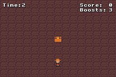

# Caves, Crystals and ‘Condas

Authors: Russell Fisher, Corey Brown.
Completed; 10/12/2026.

This is a simple collectathon type game in which the player attempts to collect 30 points within 
56 seconds. Chests are one point, diamonds are worth two points. Hindering the player are snakes 
that spawn more and more (up to three) as they accumulate more points. Touching  snake applies a 
temporary speed debuff. The player has three speed boost which can be replenished only when all 
boosts have been exhausted.

<!-- Link -->
Play it here! [https://roughhouserandy.github.io/collectathon/]

